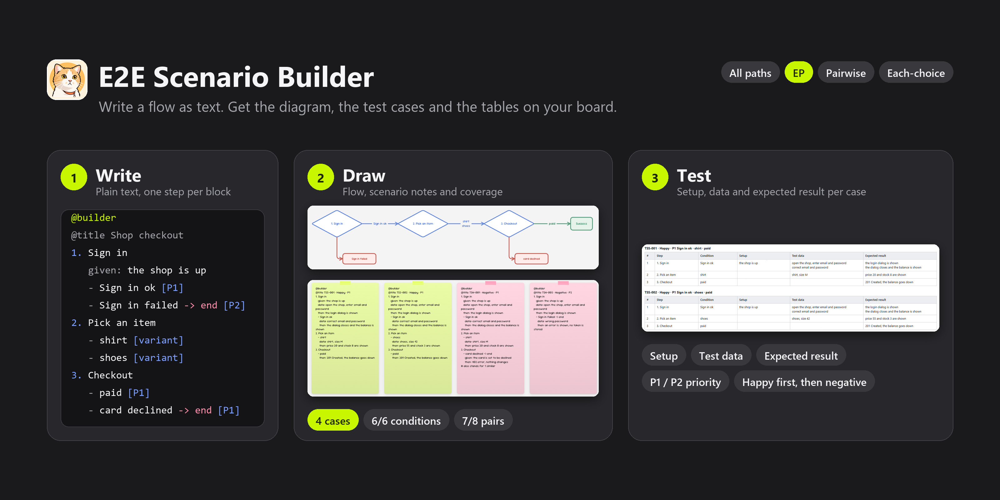

<p align="center"></p>

# E2E Scenario Builder — Drawdy extension

Write an end-to-end flow as plain text, and get the flow diagram and its test
scenarios (happy, negative and loop cases) drawn on the board, with a table of the
test sequence for each case.

Install the extension, click its button on the right edge of the board, write a flow
(or select a sticky note that starts with `@builder`) and press **Flow + Cases**.



```
@builder
@title Shop checkout
1. Sign in
   given: the shop is up
   data: user a
   then: the login dialog closes
   - Sign in ok [P1]
   - Sign in failed -> end [P2]
2. Pick an item
   - shirt [variant]
   - shoes [variant]
   - sold out -> loop to step 2 max 2 [negative]
3. Checkout
   - paid [P1]
   - card declined -> end [P1]
```

## How to use

1. **Open the panel.** Click the extension's button on the right edge of the
   board.
2. **Write a flow** in the text box (syntax below), or write it in a sticky note
   whose first line is `@builder`, select the note and press
   **Pull from selected note** to fill the box.
3. **Watch the numbers.** While you type, the panel shows the number of steps
   and of test cases in every mode (All, EP, Pairwise, Each-Choice), the problems
   found in the text (with their line) and in the flow.
4. **Pick the mode** with the switch (All, EP, Pair, Each; EP is the default). Under
   it the panel says how many cases that mode makes, and warns above 50.
5. **Press a button.**

| Button | Result |
| --- | --- |
| **Flow** | The flow diagram only. With a case note selected it reads **Flow + Table**: the flow of that case, and under it the table of that case |
| **Cases** | The scenario notes of the chosen mode, without the diagram |
| **Flow + Cases** | The flow diagram, then a frame of scenario notes whose header shows the counts of all four modes and how much of the flow the cases cover |
| **Table** | The test sequence of the cases as tables (step, condition, setup, test data, expected result) |
| **Copy table** | Copies those tables as tab-separated text to the clipboard, ready to paste into a spreadsheet |

### What the buttons use

A selection on the board wins over the text left in the panel. The panel says what
the buttons will use ("The buttons below will use ..."), the **Table** and **Copy table**
labels follow it, and buttons that do not fit the selection are greyed out.

| Selected on the board | Flow | Cases | Flow + Cases | Table / Copy table |
| --- | --- | --- | --- | --- |
| nothing, with a flow in the text box | on | on | on | all cases of the mode |
| nothing, text box empty | off | off | off | off |
| a case note (`TSS-…` / `TSN-…`) | **Flow + Table**: that case | off | off | only the selected cases |
| a scenario frame | off | on (cases again, chosen mode) | off | all cases in the frame |
| a drawn flow frame | off | on (new cases) | on | cases of the chosen mode |
| a sticky note that starts with `@builder` | on | on | on | its cases |
| a table | off | off | off | **Copy table** copies that table |

**Only sticky notes that start with `@builder` are read.** Any other note is left
alone, so the extension never spends time on notes that are not flows. (The text box
in the panel does not need the marker.)

### What is drawn

- New results are placed in free space: under the selected note, or in view if
  nothing is selected. If something is already there, the result moves down.
- Scenario notes are coloured: green = happy path, pink = negative, orange = loop.
  They are ordered happy cases first, then negative, each by priority. IDs are
  `TSS-001…` (success) and `TSN-001…` (negative).
- Each scenario note is itself written in the flow syntax (`@builder`, a
  `@title TSS-001 · Happy · P1`, the steps and choices of that case with their
  `given:` / `data:` / `then:`), so it can be selected and read back.
- A lot of cases is laid out in more columns, so the frame stays about as wide as
  it is tall. There is no limit on the number of notes, but the panel warns when a
  mode makes more than 50.
- A table is one embedded page of the board. **Drawdy's canvas catches the mouse over
  embedded pages, so a table cannot be scrolled or clicked on the board**; it is
  drawn at its full height instead (worked out from the column widths, so there can
  be some empty space below it). Copy it with the **Copy table** button.

## Text syntax

Everything can be written in the text, so no UI is needed.
The words are English; the labels you write can be in any language.

```
@builder
@title Shop checkout            (optional: the name of the drawn frame)

1. Open the shop and sign in    <- a step: a number, then its name
   given: the stack is up       <- fields of the step (before its first condition)
   data: user a
   then: login dialog closes
   req: R-12
   - Sign in ok [P1]            <- a condition: a choice at this step
   - Sign in failed -> end [P2]
     then: error is shown       <- fields of the condition above
2. Pick an item
   - shirt [variant]
   - shoes [variant]
   - sold out -> loop to step 2 max 2 [negative]
```

### Lines

| A line that starts with | Is |
| --- | --- |
| `@builder` | the marker: the note is a flow (must be the first line) |
| `@title name` | the title of the drawn frame |
| `1.` or `1)` (a number) | a **step**. The number is how `loop to step` refers to it |
| `-` (also `*`, `•`) | a **condition** of the step above |
| `given:` `data:` `then:` `req:` | a **field**: setup (precondition), test data, expected result, requirement id. The older names `setup:` and `expect:` are still read |
| `#` or `//` | a comment (ignored) |

A field belongs to the step if it comes before the step's first condition, and to
the last condition above it otherwise. A value can go on over the next lines;
start such a line with `\` if it would look like a step, a condition or a field
(`\- not a condition`). Blank lines are fine anywhere. **Indentation is never
needed**: a sticky note may not keep it, so a line is told apart by how it starts.

### What a condition does

Put one of these after the label of a condition (`- label -> something`). The
words are `end`, `loop`, `next`, in any letter case; `->` can also be
written `→` or `=>`.

| Write | Meaning |
| --- | --- |
| `- label` | continue to the next step (a normal path) |
| `- label -> end` | **negative**: the flow ends here |
| `- label -> loop` | go round the **same step** again |
| `- label -> loop to step 3` | go **back to step 3** (the step number written before the step's name) |
| `- label -> loop max 2` | limit the rounds: `max 2`. Default 1, up to 9. Works with both forms of `loop`, e.g. `-> loop to step 3 max 2` |
| `- label -> next` | continue (the default, written out; use it with `[negative]`) |

### Options (optional, in square brackets at the end, separated by commas)

| Write | Meaning |
| --- | --- |
| `P1` `P2` `P3` | priority of the case (no option = P2; a case takes the highest number on its path) |
| `variant` | this choice does not multiply with the others, so equivalence partitioning keeps one representative case |
| `negative` | a failing choice that does not end the flow (`end` is already negative) |
| `sets lv1` | marks the path with a tag (several: `sets lv1 lv2`) |
| `needs lv1 and master` | only reachable if the path already has these tags. Words: `and`, `or`, `not` (or `!`). `or` binds tighter than `and`, and there are no brackets: `needs !master or lv2` and `needs master and lv1` |

### A complete example

```
@builder
@title Shop purchase
1. Open the shop and sign in
   given: the stack is up
   data: open the shop, fill in the email and password
   then: the login dialog is shown
   req: 09-frontend
   - Sign in ok [P1]
     data: correct email and password
     then: the dialog closes, the wallet balance is shown
   - Sign in failed -> end [P2]
     data: wrong password
     then: an error is shown and there is no token
2. Check the account
   data: GET /api/account-info
   then: the UI reads the level and the status
   - Verified level 1 [P1, variant, sets lv1]
     given: the test API sets level 1 / ACTIVE
     then: normal items can be bought, premium items cannot
   - Verified level 2 [P1, variant, sets lv2]
     given: the test API sets level 2 / ACTIVE
     then: everything can be bought
   - Not verified -> end [P1]
     given: the test API sets level 0
     then: the verify-identity dialog is shown, checkout is disabled
3. Pick from the catalog
   - Pick a normal item [variant]
     data: ultra-ball #2
   - Pick a premium item [P1, variant, sets premium]
     data: master-ball #1
4. Buy more?
   - Yes -> loop to step 3 [P2, variant]
   - No
5. Purchase rules
   then: the API checks KYC before stock and wallet
   - All rules pass [P1, needs !premium or lv2]
     then: 201 Created, the wallet and the stock go down
   - Level required -> end [P1, needs premium and lv1]
     then: 403 KYC_LEVEL_REQUIRED, nothing changes
   - Not enough funds -> end [P1, needs !premium or lv2]
     given: the wallet is lower than price x quantity
     then: 422 INSUFFICIENT_FUNDS, nothing changes
6. Shipping worker creates the label
   given: the shipping mock is set to success
   - Got a tracking number [P1]
     then: the status is LABEL_CREATED and there is a tracking number
   - Provider down, retry -> loop max 2 [P2, variant, negative]
     given: the mock is set to unavailable, then success
     then: RETRY_WAIT, then the label is created without a new purchase
   - Retries used up -> end [P2]
     then: the status is FAILED and retries stop
```

### The one-line form

The earlier short form still works, for small flows. Steps are separated by `>`,
the conditions of a step go in parentheses separated by `|`:

```
@builder
Login (ok | !fail) > Pick item (shirt | shoes) > Checkout (paid | !card declined)
```

| Write | Meaning |
| --- | --- |
| `!label` | negative, the flow ends |
| `-label` | negative, the flow continues |
| `~3 label` | go back to step 3 (`~` alone repeats the same step); `!~4` / `-~4` is negative and loops |
| `label [P1 tag=x need=a,b variant max=2]` | options. `need`: `,` = and, `/` = or, `!` = not. `max` = rounds of a loop |
| `@ep` `@all` `@pair` `@min` (first word) | the mode, instead of the panel's switch |

A text is read in the block form when any line starts with a number or a `- `
bullet, and as the one-line form otherwise.

### Reading problems

A problem in the text is shown with its line (in the panel while you type), for example `Line 5: Unknown option "varient" in [ ] (did you mean variant?)`.
The extension points out unknown words with the closest known one, a `loop to step` pointing to a
step that does not exist, repeated or out-of-order step numbers, a condition with
no step, a field with a typo, and so on.

## Modes

Choose the mode with the panel's switch.

| Mode | What you get |
| --- | --- |
| EP (equivalence partitioning) | one representative per group of equivalent paths. Only choices marked `variant` are grouped, so without any `variant` EP stays close to All; the panel says so |
| All | every path that can actually be walked |
| Pairwise (2-wise) | every pair of conditions that can meet is in at least one case |
| Each (each-choice, 1-wise) | the fewest cases that touch every condition once |

The header of the scenario frame always shows the counts of all four modes, so
you can compare them.

### Flow check

The panel and the scenario frame list problems found in the flow: a step no case
can reach, a condition no case uses, a `needs` that refers to a tag nobody sets, a
loop that points forward, duplicate or empty labels.

## Notes

- The flow is kept in the `meta` of the drawn frame, so scenarios can be
  regenerated later by selecting that frame.
- Permissions: `dom` (the button and the window) and `scene` (reading the selection
  and drawing on the board).
- This version of Drawdy lets an extension have one toolbar button.

## Development

```
npm run dev        # dev server for "Add extension dev server" in Drawdy
npm test           # tests: text syntax, scenarios, tables, the buttons (see below)
npm run gen:editor # rebuild the pages embedded in src/ (runs before dev and build)
```

### Tests

`npm test` needs no browser and no extra packages:

- `test/syntax.test.ts`: the text syntax, the scenario counts, notes and tables.
- `test/driver.test.ts`: the driver against a small fake Drawdy host (an in-memory
  scene), and the panel page against a stub DOM. It checks what each button does for
  each kind of selection (case note, scenario frame, flow frame, table, `@builder`
  note, nothing), the copy text, where a table is placed, and which buttons are on.

These tests do not see how things *look*, or what Drawdy itself does. Before a
release, check by hand in Drawdy (about five minutes):

1. Add the dev server, allow the permissions, click the extension's button: the
   panel opens in English.
2. Type a flow with `given:` / `data:` / `then:`: the counts and the "Mode EP: N
   cases" line appear; a typo shows `Line N: ...`.
3. **Flow + Cases**: a flow frame and a scenario frame appear, happy cases first.
4. Select one case note: the line says "1 case note(s) selected", **Flow** reads
   **Flow + Table**, **Cases** and **Flow + Cases** are greyed out. Press **Table**
   and **Flow + Table**: one table, and the case's flow with its table.
5. Select the scenario frame and press **Copy table**, then paste into a
   spreadsheet: one row per step, a **Case** column first.
6. Select a table and press **Copy table**: it copies that table.

`src/syntax.ts` is the only place that reads the text syntax, so the panel and
the board actions always agree. `gen:editor` only embeds `editor/panel.html`
into `src/panelHtml.ts`.

## Credits

The scenario generation (paths, equivalence partitioning, pairwise, each-choice
and flow checks) is the author's own work, written for this extension.
