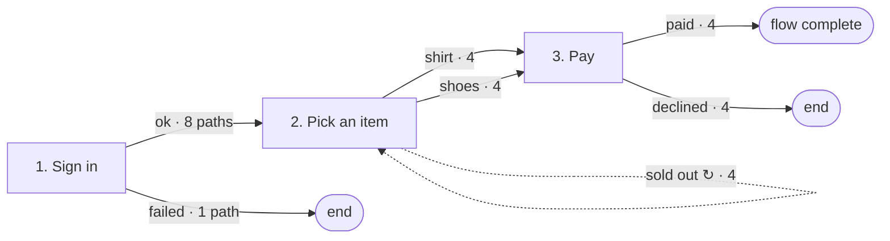

# E2E Scenario Builder — Drawdy extension

Write an end-to-end flow as plain text, and get the flow diagram and its test
scenarios (happy, negative and loop) drawn on the board, with a table of the
test steps of each scenario.

Install the extension, click its button on the right edge of the board, press a
**Start with a template** button to drop a ready-made flow note on the
board, edit it there, select it and press **Flow + Scenarios**. (Or write a flow in the
panel's paste box, or in any note, sticky note or text box, that starts with `@builder`.)


## Contents

- [Terms](#terms)
- [How to use](#how-to-use)
  - [What the buttons use](#what-the-buttons-use)
  - [What is drawn](#what-is-drawn)
- [Text syntax](#text-syntax)
  - [Lines](#lines)
  - [What a condition does](#what-a-condition-does)
  - [Options](#options)
  - [The one-line form](#the-one-line-form)
  - [Reading problems](#reading-problems)
- [Scenario IDs](#scenario-ids)
- [How the scenarios are counted](#how-the-scenarios-are-counted)
- [Modes](#modes)
  - [What each mode guarantees](#what-each-mode-guarantees)
    - [The math](#the-math)
  - [Flow check](#flow-check)
- [Decision table](#decision-table)
- [Writing a flow that tests well](#writing-a-flow-that-tests-well)
- [Notes](#notes)
- [Development](#development)
  - [Tests](#tests)
- [Credits](#credits)
- [License](#license)

```
@builder
@title Online shop: checkout

1. Authentication
   req: R-01
   given: the shop is up, the shipping fee table is Standard 5.00 and Express 12.00
   - Log in [P1]
     sets: user
     data: username user_001, password Passw0rd!
     then: 200 OK, the header shows "user_001", a session token is issued
   - Continue as guest [P2]
     sets: guest
     data: no account, email guest@example.com
     then: 200 OK, the header shows "Guest", no session token
2. Select Products
   req: R-02
   given: the catalog has SKU-001 Shirt 20.00 and SKU-002 Shoes 50.00, both in stock
   - Shirt [variant]
     data: SKU-001, quantity 1
     then: the product page shows price 20.00
   - Shoes [variant]
     data: SKU-002, quantity 1
     then: the product page shows price 50.00
3. Add to Shopping Cart
   - Added [P1]
     then: 201 Created, the cart item count goes up by 1, the cart line shows the SKU and its price
   - Out of stock -> end [negative]
     given: the stock of the product is 0
     then: 409 OUT_OF_STOCK, the cart item count does not change
```

The first three steps of the starter template (**Start with a template** drops all of it on the board). The whole text is under [Text syntax](#text-syntax).

## Terms

| Word | Means |
| --- | --- |
| **Flow** | The whole business flow you write: steps, each with its choices |
| **Scenario** | One path through the flow, from the first step to where it ends: several test steps in a row. It is **Happy** when it completes the flow (loops included) and **Negative** when it ends early. IDs are `TSS-001` (happy) and `TSN-001` (negative): see "Scenario IDs" below |
| **Test step** | One step of a scenario with the choice taken there, and its setup (`given:`), test data (`data:`) and expected result (`then:`). It is one row of a Test steps table |

So a scenario is a chain of test steps, and the number the panel shows is the number
of scenarios.

## How to use

1. **Open the panel.** Click the extension's button on the right edge of the
   board.
2. **Write a flow.** The panel is small, so write on the board: press **Start with a
   template** to drop a note with a ready-made online-shop checkout that uses every piece of
   the syntax, explained in `#` comment lines (they are ignored; delete them when done),
   and edit it there. Any note whose first line is `@builder` works the same.
   You can also type in the panel's **Paste or type text here** box, or press
   **Pull from selected note** in it to fill the box from a note.
   While one flow note is selected, the panel shows that note's scenario counts, the
   flow check and a mode tip, updated as you edit it; with nothing selected it counts
   the paste box.
3. **Watch the numbers.** While you type, the panel shows the number of steps
   and of test scenarios in every mode (All, EP, Pairwise, Each-Choice), the problems
   found in the text (with their line) and in the flow.
4. **Pick the mode** with the switch (All, EP, Pair, Each; EP is the default). Under
   it the panel says how many scenarios that mode makes, and warns above 50.
5. **Press a button.**

| Button | Result |
| --- | --- |
| **Flow** | The flow diagram only. With a scenario note selected it reads **Flow + Test steps**: the flow of that scenario, and under it its test steps |
| **Scenarios** | The scenario notes of the chosen mode, without the diagram |
| **Flow + Scenarios** | The flow diagram, then a frame of scenario notes whose header shows the counts of all four modes and how much of the flow the scenarios cover |
| **Test steps** | The test steps of each scenario, in order, as tables: one row per test step (step, condition, setup, test data, expected result) |
| **Decision table** | A decision table of the same scenarios: the steps that decide as rows, each scenario as a column. See [Decision table](#decision-table) |
| **Copy to clipboard** | Copies those tables, or a selected table or decision table, as tab-separated text to the clipboard, ready to paste into a spreadsheet |
| **Copy decision table** | Copies the decision table of the same scenarios, without drawing it and with no limit on scenarios: one long row of scenarios, so you can freeze the first two columns in the spreadsheet |

### What the buttons use

A selection on the board wins over the text left in the panel. The panel says what
the buttons will use ("The buttons below will use ..."), the **Test steps**, **Decision table** and **Copy to clipboard**
labels follow it (they end with how many scenarios they use), and buttons that do not fit the selection are greyed out.

| Selected on the board | Flow | Scenarios | Flow + Scenarios | Test steps / Decision table / Copy to clipboard / Copy decision table |
| --- | --- | --- | --- | --- |
| nothing, with a flow in the text box | on | on | on | all scenarios of the mode |
| nothing, text box empty | off | off | off | off |
| a scenario note (`TSS-…` / `TSN-…`) | **Flow + Test steps**: that scenario | off | off | only the selected scenarios |
| a scenario frame | off | on (scenarios again, chosen mode) | off | all scenarios in the frame |
| a drawn flow frame | off | on (new scenarios) | on | scenarios of the chosen mode |
| a note that starts with `@builder` | on | on | on | its scenarios |
| a table or a decision table | off | off | off | **Copy to clipboard** copies that table; the rest are off |

**Only notes that start with `@builder` are read.** Any other note is left
alone, so the extension never spends time on notes that are not flows. (The text box
in the panel does not need the marker.)

### What is drawn

- New results are placed in free space: under the selected note, or in view if
  nothing is selected. If something is already there, the result moves down.
- Scenario notes are text boxes filled with a colour: green = happy path, pink = negative, orange = loop. Each is as tall as its text needs.
  They are ordered happy scenarios first, then negative, each by priority. IDs are
  `TSS-…` (success) and `TSN-…` (negative), running numbers from 001.
- Each scenario note is itself written in the flow syntax (`@builder`, a
  `@title TSS-001 · Happy · P1`, the steps and choices of that scenario with their
  `given:` / `data:` / `then:`), so it can be selected and read back.
- A lot of scenarios is laid out in more columns, so the frame stays about as wide as
  it is tall. There is no limit on the number of notes, but the panel warns when a
  mode makes more than 50.
- A table is one embedded page of the board. **Drawdy's canvas catches the mouse over
  embedded pages, so a table cannot be scrolled or clicked on the board**; it is
  drawn at its full height instead (worked out from the column widths, so there can
  be some empty space below it). Copy it with the **Copy to clipboard** button.
- A decision table is the exception: it is made of ordinary boxes, so it can be edited
  on the board (see [Decision table](#decision-table)).

## Text syntax

Everything can be written in the text, so no UI is needed.
The words are English; the labels you write can be in any language.

This is the starter template, the note that **Start with a template** drops on the board. It is the standard example for everything below: the `#` lines explain each piece of the syntax as it is used, and the tables after it list the same pieces.

```
@builder
@title Online shop: checkout
# One template that shows the whole syntax. Lines starting with # are ignored.
# 1. Step           a step: a number, then its name
# - choice          a choice at that step (a step may have many)
# [P1] [P2] [P3]    priority: the lowest P on a scenario is its priority
# given: data: then:  setup, test data, expected result (before a choice = the step)
#                   then: is a value to assert (a number, status or code), never just "works"
# req: R-01         a requirement id, on a step or a choice
# -> end            the flow stops here: a negative scenario
# -> loop to step 2 max 2   go back to step 2, at most 2 rounds
# [distinct]        on a loop: a round offers only choices not picked yet
# [variant]         choices marked variant do not multiply each other in EP
# [negative]        a choice that fails but the flow goes on
# needs: x          a choice only a path with tag x can take (and, or, not / !)
# sets: x           this choice tags the path with x
# Delete the comments and the steps you do not need.

1. Authentication
   req: R-01
   given: the shop is up, the shipping fee table is Standard 5.00 and Express 12.00
   - Log in [P1]
     sets: user
     data: username user_001, password Passw0rd!
     then: 200 OK, the header shows "user_001", a session token is issued
   - Continue as guest [P2]
     sets: guest
     data: no account, email guest@example.com
     then: 200 OK, the header shows "Guest", no session token
2. Select Products
   req: R-02
   given: the catalog has SKU-001 Shirt 20.00 and SKU-002 Shoes 50.00, both in stock
   - Shirt [variant]
     data: SKU-001, quantity 1
     then: the product page shows price 20.00
   - Shoes [variant]
     data: SKU-002, quantity 1
     then: the product page shows price 50.00
3. Add to Shopping Cart
   - Added [P1]
     then: 201 Created, the cart item count goes up by 1, the cart line shows the SKU and its price
   - Out of stock -> end [negative]
     given: the stock of the product is 0
     then: 409 OUT_OF_STOCK, the cart item count does not change
4. Calculate Total
   then: the subtotal is the sum of the prices in the cart: 20.00 (shirt), 50.00 (shoes) or 70.00 (both)
5. More product?
   - Add another product -> loop to step 2 max 2 [distinct]
     then: the product list opens again, the cart item count is still 1 after round 1
   - No more product [P1]
     then: the page moves to shipping, the cart item count is unchanged (1 or 2)
6. Select Shipping Methods
   - Standard [P1]
     then: the shipping method is Standard, the fee is 5.00
   - Express (members only) [P2]
     needs: user
     then: the shipping method is Express, the fee is 12.00
7. Add shipping Charge
   data: weight 1 kg
   - Charge added [P1]
     then: the shipping charge equals the fee of the method: 5.00 (Standard) or 12.00 (Express)
   - Free shipping (members only) [P2]
     needs: user
     data: promo code FREESHIP
     then: the shipping charge is 0.00 and the order total equals the subtotal
8. Enter Shipping Info
   - Use saved address (members only)
     needs: user
     data: address id addr_001, 12 Main St, Springfield, 12345
     then: the shipping address is 12 Main St, Springfield, 12345
   - Type a new address [P1]
     data: 99 Oak Ave, Austin, TX, 73301
     then: the address check returns valid, the shipping address is 99 Oak Ave, Austin, TX, 73301
9. Select Payment Methods
   - Saved card (members only)
     needs: user
     data: the card saved on user_001, ending 4242
     then: the payment method shows "Visa ending 4242"
   - New card [P1]
     data: card 4111 1111 1111 1111, expiry 12/30, CVV 123
     then: the payment method shows "Visa ending 1111"
   - Cash on delivery (guests only)
     needs: !user
     sets: cod
     then: the payment method is COD, the amount due on delivery is the order total
10. Verify Credit Info Complete?
   req: R-03
   - Payment succeeded [P1]
     then: the order status is CONFIRMED, a receipt email with the order number and the total is sent
   - Payment failed -> end [P2]
     needs: !cod
     data: test card 4000 0000 0000 0002
     then: the gateway returns CARD_DECLINED, the order status stays PENDING_PAYMENT, the amount charged is 0.00
```

### Lines

| A line that starts with | Is |
| --- | --- |
| `@builder` | the marker: the note is a flow (must be the first line) |
| `@title name` | the title of the drawn frame |
| `1.` or `1)` (a number) | a **step**. The number is how `loop to step` refers to it |
| `-` (also `*`, `•`) | a **condition** of the step above |
| `given:` `data:` `then:` `req:` | a **field**: setup (precondition), test data, expected result, requirement id. The older names `setup:` and `expect:` are still read. Several requirement ids go on one line, separated by commas. The scenario frame header lists each requirement with the scenarios that pass it (a step's `req` counts for every scenario through the step, a choice's for every scenario that takes it) and names any requirement the chosen mode leaves out |
| `needs:` `sets:` | a **condition field** of a choice: the tags a path must already have to take it, and the tags it adds. Written on lines of their own under the choice, one line each (see [Options](#options)). Not for a step |
| `#` or `//` | a comment (ignored) |

A field belongs to the step if it comes before the step's first condition, and to
the last condition above it otherwise. A value can go on over the next lines;
start such a line with `\` if it would look like a step, a condition or a field
(`\- not a condition`). Blank lines are fine anywhere. **Indentation is never
needed**: a note may not keep it, so a line is told apart by how it starts.

### What a condition does

Put one of these after the label of a condition (`- label -> something`). The
words are `end`, `loop`, `next`, in any letter case; `->` can also be
written `→` or `=>`.

| Write | Meaning |
| --- | --- |
| `- label` | continue to the next step (a normal path) |
| `- label -> end` | **negative**: the flow ends here |
| `- label -> loop` | go round the **same step** again |
| `- label -> loop to step 3` | go **back to step 3** (the step number written before the step's name) |
| `- label -> loop max 2` | limit the rounds: `max 2`. Default 1, up to 9. Works with both forms of `loop`, e.g. `-> loop to step 3 max 2` |
| `- label -> next` | continue (the default, written out; use it with `[negative]`) |

### Options

Optional, in square brackets at the end of a condition, separated by commas. `sets` and `needs` are better as lines of their own under the choice (`sets: lv1`, `needs: lv1 and premium`), so a long rule does not push the label out of sight; the bracket spelling `[sets lv1, needs premium]` still works and gives the same scenarios. If both are written on one choice, the line wins and the extension warns.

| Write | Meaning |
| --- | --- |
| `P1` `P2` `P3` | priority of the scenario: a scenario takes the most important (lowest) number on its path, so a path with a P1 choice is P1. Choices without a `P` do not count; no `P` on the whole path = P2 |
| `variant` | this choice does not multiply with the others, so equivalence partitioning keeps one representative scenario |
| `negative` | a failing choice that does not end the flow (`end` is already negative) |
| `distinct` | on a `loop to step N`: the next round offers only the choices not taken yet at the step it goes back to (the steps after it are free), and rounds that differ only in order count once. For "add another item": `- add more -> loop to step 3 [distinct]` gives A, B, A+B, not A+A or B+A as well. Ends and loops at those steps stay available |
| `sets lv1` (or the line `sets: lv1`) | marks the path with a tag (several: `sets lv1 lv2`) |
| `needs lv1 and premium` (or the line `needs: lv1 and premium`) | only reachable if the path already has these tags. Words: `and`, `or`, `not` (or `!`). `or` binds tighter than `and`, and there are no brackets: `needs !premium or lv2` and `needs premium and lv1` |

### The one-line form

The earlier short form still works, for small flows. Steps are separated by `>`,
the conditions of a step go in parentheses separated by `|`:

```
@builder
Select Products (Shirt | Shoes) > Add to Shopping Cart (Added | !Out of stock) > Select Shipping Methods (Standard | Express)
```

| Write | Meaning |
| --- | --- |
| `!label` | negative, the flow ends |
| `-label` | negative, the flow continues |
| `~3 label` | go back to step 3 (`~` alone repeats the same step); `!~4` / `-~4` is negative and loops |
| `label [P1 tag=x need=a,b variant max=2]` | options. `need`: `,` = and, `/` = or, `!` = not. `max` = rounds of a loop |
| `@ep` `@all` `@pair` `@min` (first word) | the mode, instead of the panel's switch |

A text is read in the block form when any line starts with a number or a `- `
bullet, and as the one-line form otherwise.

### Reading problems

A problem in the text is shown with its line (in the panel while you type), for example `Line 5: Unknown option "varient" in [ ] (did you mean variant?)`.
The extension points out unknown words with the closest known one, a `loop to step` pointing to a
step that does not exist, repeated or out-of-order step numbers, a condition with
no step, a field with a typo, and so on.

## Scenario IDs

Scenarios are numbered in the order the board lists them (Happy first, then by
priority): the Happy ones are `TSS-001`, `TSS-002`, `TSS-003`..., the Negative ones
`TSN-001`, `TSN-002`... With 3 Happy and 2 Negative scenarios you get `TSS-001` to
`TSS-003` and `TSN-001`, `TSN-002`.

Each mode numbers what it picks. The scenarios of EP, Pair or Each count again from
`001`, so the biggest ID of a mode is its count: Each-Choice with 5 scenarios, 3 Happy
and 2 Negative, ends at `TSS-003` and `TSN-002`, however many All has. The scenario
notes, the tables, the copied text and the decision table of one mode all use these IDs,
so an ID traces back from any of them. The same scenario can have another ID in another
mode, so name the mode when you quote an ID.

The same flow always gives the same IDs. When you change the flow and a scenario is
added or removed, the IDs after it move: a new scenario in the middle of the Happy list
turns the old `TSS-003` into `TSS-004`. So when a ticket or a test management tool
refers to an ID, regenerate and check the scenario it points to before you trust the
number.

Boards drawn by earlier versions show `TSS-04821`-style IDs (0.2.0 and 0.3.0); they
still work, as does any `TSS-`/`TSN-` number.

## How the scenarios are counted

**All** walks every path the flow allows, from step 1 to where it ends. Here is a
small flow to count by hand:

```text
1. Sign in
- ok
- failed -> end
2. Pick an item
- shirt
- shoes
- sold out -> loop to step 2 [negative]
3. Pay
- paid
- declined -> end
```



The number on an arrow is how many of the scenarios use that choice. There are **9**
scenarios: 4 Happy (they reach the end of step 3) and 5 Negative (they stop on an
`-> end`).

To check a count yourself, work backwards from the last step. Let *P(step)* be the
number of ways to finish from that step; a choice adds 1 if it ends the flow, or
*P(next step)* if it continues:

- Step 3: paid → 1 (flow complete) + declined → 1 (end) = **2**
- Step 2, after the loop has been used (the `sold out` choice is no longer offered):
  shirt → 2 + shoes → 2 = **4**
- Step 2, loop still available: shirt → 2 + shoes → 2 + sold out → 4 = **8**
- Step 1: ok → 8 + failed → 1 = **9**

What each part of the syntax does to the count:

| In the flow | Effect |
| --- | --- |
| A step with several choices | one branch per choice; the branches multiply with the steps after them |
| A step with no choices | passes through; no effect |
| `-> end` | that branch stops there and is one Negative scenario, however many steps remain |
| `-> loop to step N` | goes back and takes that step again. Each use counts against `max` (default 1); once used up, the choice is simply no longer offered, it does not end the scenario |
| `sets` / `needs` | a choice with `needs` is offered only if the path already carries the tag; a tag stays for the rest of the path. Choices that cannot be offered are cut, together with every scenario through them |
| `distinct` | on a loop back to a step: the choices already taken at that step are not offered again, and rounds that differ only in order count once |

`sets` / `needs` is what keeps impossible paths out. In this flow, only 2 of the 4
combinations can happen:

```text
1. Account
- level 1 [sets lv1]
- level 2 [sets lv2]
2. Buy a premium item
- allowed [needs lv2]
- blocked -> end [needs lv1]
```

Level 1 can only be blocked, level 2 can only be allowed, so there are **2** scenarios
(1 Happy, 1 Negative) instead of 4.

The other modes pick from these scenarios (see Modes below). They never invent a
scenario: EP, Pair and Each give a subset of what All lists.

## Modes

Choose the mode with the panel's switch.

| Mode | What you get |
| --- | --- |
| EP (equivalence partitioning) | one representative per group of equivalent paths. Only choices marked `variant` are grouped, so without any `variant` EP stays close to All; the panel says so |
| All | every path that can actually be walked. Past 1,000 paths it lists the first 1,000 and adds one path for each choice and pair they missed, so the other modes can still cover them; the flow check says so |
| Pairwise (2-wise) | every choice, and every pair of choices that can meet on a path, is in at least one scenario |
| Each (each-choice, 1-wise) | a small set of scenarios that touch every choice, Happy paths first. Not always the smallest possible |

The header of the scenario frame always shows the counts of all four modes, so
you can compare them, and the panel and the header give a `TIP:` for this flow:

- All has 30 scenarios or fewer: run them all.
- No choice is marked `variant`: EP stays close to All, so use Pair (every pair of
  choices) or Each (a quick pass), or mark interchangeable choices `variant`.
- Otherwise: EP for regression by your `variant` groups, Pair when choices at
  different steps affect each other, Each for a smoke pass.

### What each mode guarantees

"Coverage" means something different in each mode, and only All covers every path.
The header of a scenario frame prints the coverage it measured against All
(choices, loop ends and pairs, as `x/y`), then either `OK: every choice … is
covered` or `MISSING …` with the names of what is left out, so you do not have to
take it on trust. The panel shows an `ERROR` if any mode ever misses what it promises
(it should not happen; it is a safety net).

| Mode | How it picks | Always covers | Does not promise |
| --- | --- | --- | --- |
| All | every path, up to 1,000 (past that: the first 1,000, plus a path found for each choice, loop end and pair the first 1,000 missed) | every path while under 1,000 | every path past 1,000 |
| EP | one scenario per group of paths that use the same choices once `variant` choices are left out (order ignored), then one more for any choice or loop end still uncovered | every choice, every loop at its full `max`, and every group your `variant` marks define | every pair of choices |
| Pairwise | greedy: take the scenario that covers the most choices, loop ends and pairs not yet covered (ties: higher priority, then shorter), until nothing is left | every choice, every loop at its full `max`, and every pair of choices that can share a path | three choices together, order, every number of rounds in between |
| Each | greedy, taking Happy paths first, then paths with at most one failing choice, then any, until every choice and loop end is covered | every choice, every loop at its full `max` | any two choices together, every number of rounds in between |

So every mode reaches 100% of what it promises, but only All reaches 100% of the
paths. A "loop end" is a loop with `max 2` or more taken its full `max` times: every
mode has at least one scenario that does it, because the last round allowed is a
boundary worth testing. The rounds in between (for `max 3`: 1 and 2 rounds) are only
in All.

#### The math

**Counting paths (All).** Work backwards from the last step, as in "How the scenarios
are counted". With no `end`, `loop` or `needs`, the number of paths is the product of
the number of choices at each step (a step with none counts as 1).

**Loops.** A loop choice with `max m` can be taken at most m times on a path, so a
step is passed at most m + 1 times. Going round a step with k choices, whose
steps in between can be passed in q ways, gives (k·q)^r paths for r passes, added
up for r from 1 to m + 1.

**`distinct`.** The same loop with `distinct` allows each choice at the first step
only once and counts a set of rounds once whatever the order, so r passes give
C(k, r)·q^r paths (C is "k choose r", the number of ways to pick r different choices):

> scenarios = Σ over r = 1 … min(k, m + 1) of C(k, r) · q^r

For k = 3 choices, m = 2 and nothing in between (q = 1): 3 + 3 + 1 = 7, against
3 + 9 + 27 = 39 without `distinct`.

**EP.** The number of scenarios is the number of different sets of non-`variant`
choices on the paths (a `variant` choice that sets a tag another choice on the path `needs` still counts),
plus a few more where a choice would otherwise be left out.

**Each and Pairwise (greedy set cover).** Each scenario "covers" some items: its
choices (Each), or its choices and every pair of its choices (Pairwise). Greedy keeps
picking the scenario that covers the most items not covered yet, and stops when
all items are covered. It always stops with full coverage, because every item is on
some scenario. Finding the smallest set is a hard problem (NP-hard), so greedy can
pick more than the minimum. For Pairwise, which is plain greedy, the result is at most
about 1 + ln d times the minimum, where d is the most items one scenario covers. Each
prefers readable scenarios first, so it has no such bound.

To check a size by hand (a flow without loops):

- Each needs at least ⌈choices ÷ the most choices on one path⌉ scenarios.
- Pairwise needs at least as many scenarios as there are pairs of choices that can
  meet between the two steps with the most such pairs (a path takes one choice per
  step, so it covers one pair of those two steps).

These formulas are checked by the tests (`test/oracle.test.ts`).

### Flow check

The panel and the scenario frame list problems found in the flow: a step no scenario
can reach, a condition no scenario uses, a `needs` that refers to a tag nobody sets, a
loop that points forward, duplicate or empty labels.

## Decision table

The **Decision table** button turns the scenarios of the chosen mode into a decision
table: the steps that decide are the rows and each scenario is a column. It takes the
same scenarios as **Test steps**, so select a scenario frame, some scenario notes, a
`@builder` note or a flow frame, or write the flow in the paste box.

For this flow, in the Each-Choice mode:

```
@builder
1. Sign in
   - ok
   - failed -> end
2. Pick an item
   - shirt
   - shoes
   - sold out -> loop to step 2 [negative]
3. Pay
   - paid
   - declined -> end
```

the decision table is:

| Condition | Combinations | TSS-001 | TSS-002 | TSN-001 | TSN-002 |
| --- | --- | --- | --- | --- | --- |
| | | **Success** | | **Negative** | |
| 1. Sign in | ok | X | X | X | |
| | failed | | | | X |
| 2. Pick an item | shirt | | X | X | |
| | shoes | X | | | |
| | sold out | X | | | |
| 3. Pay | paid | X | X | | |
| | declined | | | X | |

How to read it:

- **Rows.** A step with two or more choices is a condition; its choices are the values
  in the Combinations column. A step with one choice or none is left out.
- **Columns.** The scenarios of the mode, Happy ones first under a green **Success** bar
  (they complete the flow, even through a `[negative]` choice), then the Negative ones
  under a red **Negative** bar (they end at a `-> end`). Each column is headed by the
  scenario's ID, the same one the scenario note of that mode shows (see
  [Scenario IDs](#scenario-ids)), so a column is found on the board by its ID and traces
  back to its note and its test steps.
- **X.** The scenario takes that choice. A loop marks every choice it takes at the step
  (here `TSS-001` takes `shoes` and then `sold out`). A scenario that never
  reaches a step has no X for it.
- **Boxes.** The table is made of ordinary boxes on the board, not an embedded page, so
  you can move them, add a column, or add a note for a combination the requirement does
  not cover.

A frame holds up to 10 scenarios; more are drawn in more frames, one under the other. A
decision table is drawn for at most 60 scenarios: pick EP, Pair or Each for a bigger flow,
or press **Copy decision table** to get it as text for a spreadsheet with no limit.
A flow with no step that has two or more choices has no decision table.

Select a decision table and press **Copy to clipboard** to copy it for a spreadsheet: the same
rows, with the scenario IDs as the column heads and a Group row under them.

**Copy decision table** gives that text straight from the flow, a scenario frame or selected
scenario notes, without drawing anything. Past 60 scenarios (All Paths of a big flow) it
is the way to get the table: paste it into a spreadsheet and freeze the first two columns
(Condition, Combination) so the scenarios scroll sideways.

## Writing a flow that tests well

The tool walks every path the flow allows and copies each step's fields into the
scenario. It does not know your system, so a few things stay with the writer:

- **Test data must hold on every path through it.** A scenario puts together the
  `given:` / `data:` of every step and choice it passes. If step 2 says "account
  test-user-001" and a choice at step 7 says "account test-user-premium", a scenario
  through both lists two accounts. Write data that fits every path that can reach
  it, or move it to the choice that decides it (and use `sets` / `needs` to keep
  paths that do not fit apart).
- **One choice is one outcome for the whole step.** If the system handles several
  things one by one (each line of a cart is sent as its own request), a mixed result
  such as "line 1 succeeds, line 2 is refused" only appears if you write it as its
  own choice.
- **Only allow what can really happen.** A choice reachable on paths where it cannot
  occur makes scenarios nobody can run. For example, a "gave up after the last retry"
  ending should need the retry first: `- provider down -> loop max 2 [negative, sets
  retried]` and `- retries used up -> end [needs retried]`.
- **`distinct` drops the order.** Use it when picking A then B tests the same thing
  as B then A. If the order matters (the first item fails, the second is checked
  next), leave it out.
- **A loop runs once more by default.** `-> loop to step 3` without `max` allows one
  extra round; the flow diagram shows the limit as `up to 1 time`.
- **Happy can include a failure on the way.** A scenario that takes a `[negative]`
  choice and still completes is Happy; its title says `via negative`.

## Notes

- The flow is kept in the `meta` of the drawn frame, so scenarios can be
  regenerated later by selecting that frame.
- Permissions: `dom` (the button and the window) and `scene` (reading the selection
  and drawing on the board).
- This version of Drawdy lets an extension have one toolbar button.

## Development

What the extension must do is written in [`specs/`](specs/README.md), one file per
area (panel, driver, calculation, syntax, board output, testing). The specs are the
source of truth: a change in behaviour changes the spec in the same commit, and tests
name the rules they check (`CALC-17`).

```
npm run dev        # dev server for "Add extension dev server" in Drawdy
npm test           # tests: text syntax, scenarios, tables, the buttons (see below)
npm run gen:editor # rebuild the pages embedded in src/ (runs before dev and build)
```

### Tests

`npm test` needs no browser and no extra packages. GitHub Actions runs the same checks
(plus the typecheck, the build, and that `src/panelHtml.ts` matches the panel page) on
every push and pull request:

- `test/syntax.test.ts`: the text syntax, the scenario counts, notes and tables.
- `test/driver.test.ts`: the driver against a small fake Drawdy host (an in-memory
  scene), and the panel page against a stub DOM. It checks what each button does for
  each kind of selection (scenario note, scenario frame, flow frame, table, `@builder`
  note, nothing), the copy text, where a table is placed, and which buttons are on.
- `test/specs.test.ts`: the specs themselves: rule IDs are unique and every rule a
  test names exists. `npm run spec:coverage` lists the rules no test names yet.
- `test/oracle.test.ts`: the scenario generator against a second, independent
  enumerator on random flows, plus checks that EP, Pair and Each keep every choice and
  pair, and `distinct` against its closed form.
- `test/property.test.ts`: rules that hold for every flow, with flows made by
  fast-check: writing a flow and reading it back, scenario IDs, the modes, loops and
  the decision table. A failing flow is shrunk and kept as a plain example.
- `test/decision.test.ts`: the decision table on fixed flows: which steps are
  conditions, the marks and results, how it is drawn (text boxes, bars, one frame per ten
  scenarios, the expected-results note) and the text it copies.

These tests do not see how things *look*, or what Drawdy itself does. Before a
release, check by hand in Drawdy (about five minutes):

1. Add the dev server, allow the permissions, click the extension's button: the
   panel opens in English.
2. Type a flow with `given:` / `data:` / `then:`: the counts and the "Mode EP: N
   scenarios" line appear; a typo shows `Line N: ...`.
3. **Flow + Scenarios**: a flow frame and a scenario frame appear, happy scenarios first.
4. Select one scenario note: the line says "1 scenario note(s) selected", **Flow** reads
   **Flow + Test steps**, **Scenarios** and **Flow + Scenarios** are greyed out. Press
   **Test steps** and **Flow + Test steps**: one table, and the scenario's flow with its test
   steps. The buttons sit under the headings **Draw**, **Tables** and **Export**.
5. Select the scenario frame and press **Copy to clipboard**, then paste into a
   spreadsheet: one row per test step, a **Scenario** column first.
6. Select a table and press **Copy to clipboard**: it copies that table.
7. Select the scenario frame and press **Decision table**: a frame of boxes appears under
   it, a green **Success** bar over the happy scenarios and a red **Negative** bar over
   the others, and an X where a scenario takes a choice. The boxes can be moved and edited. Select
   the frame and press **Copy to clipboard**: pasted into a spreadsheet it has the scenario
   IDs as heads and a **Group** row.
8. Press **Start with a template**: a yellow note that starts with `@builder` appears in
   view and the camera flies to it; a second press puts the next note below the first,
   not on top. Select a note and press **Flow + Scenarios**: a
   flow and scenarios are drawn. Fold and unfold **Paste or type text here**.
9. **Speed with a big flow.** Paste this into a new note (it has more than 1,000
   paths), select the note and type in it:
   `@builder` then ten steps `1. S0` … `10. S9`, each with `- a`, `- b`, `- c`, `- d`.
   While typing, the counts in the panel fade and come back about a second after you
   stop, with "counted in … s" if it took long. Drawdy must stay responsive while you
   type and while it counts (if the whole page freezes for a moment, the extension
   runs on Drawdy's main thread: report it). Then press **Flow + Scenarios**: it
   should not wait again for the count.

`src/syntax.ts` is the only place that reads the text syntax, so the panel and
the board actions always agree. `gen:editor` only embeds `editor/panel.html`
into `src/panelHtml.ts`.

## Credits

The scenario generation (paths, equivalence partitioning, pairwise, each-choice
and flow checks) is the author's own work, written for this extension.

## License

[MIT](LICENSE) © 2026 PurrCat101. You can use, change and share this extension freely; keep the copyright line and the license text with every copy, which is how the author gets credit.
